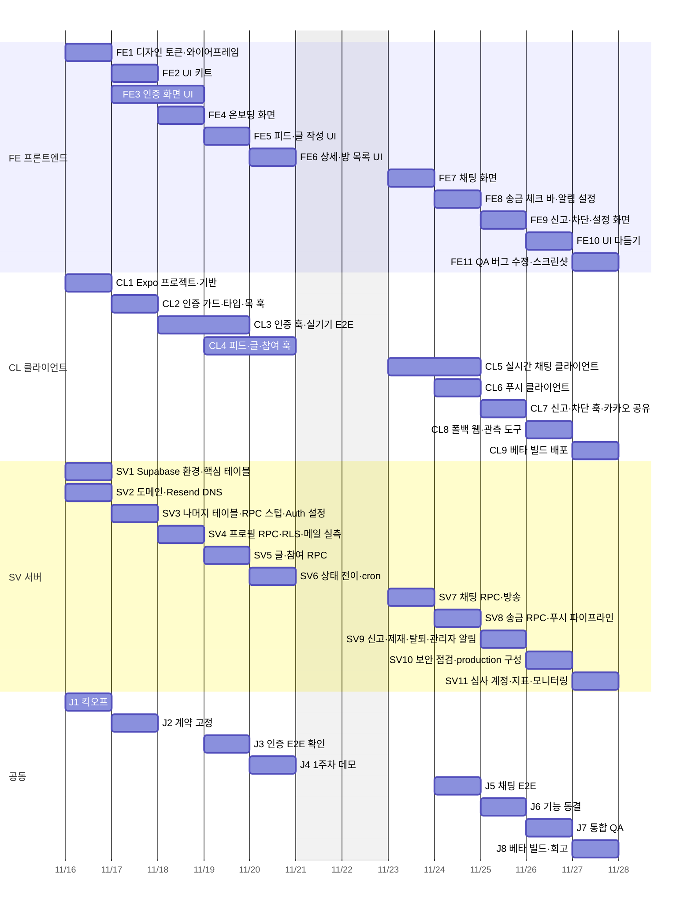

# 배달메이트 2주 개발 타임라인

> 기준 문서: [기획서](./기획서.md), [아키텍처](./아키텍처.md)  
> 기간: **2026-11-16(월) ~ 2026-11-27(금)**, 영업일 10일(D1–D10). 주말은 버퍼.  
> 목표: D10에 MUST 기능을 갖춘 베타 빌드를 TestFlight / Play 내부 테스트에 올린다. 스토어 심사와 공개 베타는 그다음 주.  
> 시각화(편집 가능): 아티팩트 "배달메이트 2주 개발 타임라인". 작업을 고치면 이 문서도 함께 갱신한다.

## 레인(역할)

| 레인 | 담당 범위 | 작업 수 |
|---|---|---|
| **FE 프론트엔드** | 화면, 디자인 시스템, 컴포넌트, 폼 UI, 빈·로딩·에러 상태 | 11 |
| **CL 클라이언트** | Expo·EAS, Supabase 연동, 세션, 데이터 훅, 실시간, 푸시, 딥링크 | 9 |
| **SV 서버** | 스키마, RLS, RPC, 트리거·cron, Auth, Edge Function, 테스트·CI | 11 |
| **공동** | 킥오프, 계약 고정, 데모, 동결, QA, 베타 | 8 |

**경계 규칙**: FE는 CL이 만든 훅만 쓴다(서버가 준비되기 전에는 같은 타입의 목 훅). CL은 DB를 직접 고치지 않고 SV에 요청한다. SV는 RPC를 바꿀 때 [아키텍처 §4](./아키텍처.md)를 먼저 고치고 공지한다.

## 전체 간트

## 마일스톤

| 날짜 | 마일스톤 | 완료 기준 |
|---|---|---|
| D2 (11/17 화) | J2 계약 고정 | 3명이 같은 타입 파일로 개발 |
| D4 (11/19 목) | J3 인증 E2E 확인 | iOS·Android 각 1대에서 통과 |
| D5 (11/20 금) | J4 1주차 데모 | 데모 시나리오 끊김 없이 동작 |
| D7 (11/24 화) | J5 채팅 E2E | 시나리오 4종 통과 |
| D8 (11/25 수) | J6 기능 동결 | MUST 항목 전부 main에 있음 |
| D10 (11/27 금) | J8 베타 빌드·회고 | 테스터에게 설치 링크 전달 |

## 일자별 보기

| 날짜 | FE 프론트엔드 | CL 클라이언트 | SV 서버 | 공동 |
|---|---|---|---|---|
| **D1** 11/16 (월) | FE1 디자인 토큰·와이어프레임 | CL1 Expo 프로젝트·기반 | SV1 Supabase 환경·핵심 테이블 SV2 도메인·Resend DNS | J1 킥오프 |
| **D2** 11/17 (화) | FE2 UI 키트 FE3 인증 화면 UI | CL2 인증 가드·타입·목 훅 | SV3 나머지 테이블·RPC 스텁·Auth 설정 | J2 계약 고정 |
| **D3** 11/18 (수) | FE3 인증 화면 UI FE4 온보딩 화면 | CL3 인증 훅·실기기 E2E | SV4 프로필 RPC·RLS·메일 실측 | — |
| **D4** 11/19 (목) | FE5 피드·글 작성 UI | CL3 인증 훅·실기기 E2E CL4 피드·글·참여 훅 | SV5 글·참여 RPC | J3 인증 E2E 확인 |
| **D5** 11/20 (금) | FE6 상세·방 목록 UI | CL4 피드·글·참여 훅 | SV6 상태 전이·cron | J4 1주차 데모 |
| **D6** 11/23 (월) | FE7 채팅 화면 | CL5 실시간 채팅 클라이언트 | SV7 채팅 RPC·방송 | — |
| **D7** 11/24 (화) | FE8 송금 체크 바·알림 설정 | CL5 실시간 채팅 클라이언트 CL6 푸시 클라이언트 | SV8 송금 RPC·푸시 파이프라인 | J5 채팅 E2E |
| **D8** 11/25 (수) | FE9 신고·차단·설정 화면 | CL7 신고·차단 훅·카카오 공유 | SV9 신고·제재·탈퇴·관리자 알림 | J6 기능 동결 |
| **D9** 11/26 (목) | FE10 UI 다듬기 | CL8 폴백 웹·관측 도구 | SV10 보안 점검·production 구성 | J7 통합 QA |
| **D10** 11/27 (금) | FE11 QA 버그 수정·스크린샷 | CL9 베타 빌드 배포 | SV11 심사 계정·지표·모니터링 | J8 베타 빌드·회고 |

## 작업 상세

### FE 프론트엔드

#### FE1 · 디자인 토큰·와이어프레임  
`D1 (11/16)` · 1일 · 1주차

앱 전체의 시각 기준과 화면 흐름을 고정함.

**세부 작업**
1. theme.ts: 색, 타이포, 간격, 반경, 다크모드 토큰
2. NativeWind 설정과 토큰 연결 확인
3. 와이어프레임: 인증 6화면, 피드, 상세, 글쓰기, 채팅, 방 목록, 설정
4. 화면 흐름도: 가입 → 프로필 → 피드 → 참여 → 채팅

| 산출물 | 선행 작업 | 완료 기준 |
|---|---|---|
| theme.ts, 와이어프레임, 화면 흐름도 | J1 킥오프 | CL·SV와 화면별 필요 데이터 대조 완료 |

#### FE2 · UI 키트  
`D2 (11/17)` · 1일 · 1주차

모든 화면이 쓰는 공용 컴포넌트를 만듦.

**세부 작업**
1. Button, Input, Chip, Card, Badge
2. Sheet(bottom-sheet), Toast, EmptyState, Skeleton
3. 라이트·다크 양쪽 확인, 터치 영역 44pt 이상

| 산출물 | 선행 작업 | 완료 기준 |
|---|---|---|
| src/components/ui/* | FE1 디자인 토큰·와이어프레임 | 카탈로그 화면에서 전 컴포넌트가 두 테마로 표시 |

#### FE3 · 인증 화면 UI  
`D2–D3 (11/17–11/18)` · 2일 · 1주차

POSTECH 메일 가입부터 비밀번호 재설정까지의 화면을 만듦.

**세부 작업**
1. 로그인, 회원가입(메일·비밀번호·약관 동의)
2. 인증 코드 입력: 6칸, 재전송 60초 타이머
3. 비밀번호 찾기·재설정
4. @postech.ac.kr 형식 오류 안내 문구

| 산출물 | 선행 작업 | 완료 기준 |
|---|---|---|
| app/(auth)/* 화면 | FE2 UI 키트, CL2 인증 가드·타입·목 훅 | 목 훅으로 가입 → 코드 입력 → 로그인 화면 전환이 동작 |

#### FE4 · 온보딩 화면  
`D3 (11/18)` · 1일 · 1주차

첫 실행 안내와 프로필 설정 화면을 만듦.

**세부 작업**
1. 접근권한 안내(필수·선택 구분, 정보통신망법 22조의2)
2. 약관·개인정보처리방침·EULA 동의 화면
3. 프로필 설정: 닉네임(중복·금칙어 오류 표시), 생활 구역 선택
4. 폼 검증 메시지 UI(react-hook-form + zod)

| 산출물 | 선행 작업 | 완료 기준 |
|---|---|---|
| permissions, terms, profile-setup 화면 | FE2 UI 키트, CL2 인증 가드·타입·목 훅 | 목 훅으로 온보딩 전체 흐름 통과 |

#### FE5 · 피드·글 작성 UI  
`D4 (11/19)` · 1일 · 1주차

핵심 화면인 피드와 글 작성 모달을 만듦.

**세부 작업**
1. 피드: 구역 칩, 글 카드(카테고리, 인원 바, 남은 시간 카운트다운)
2. 빈 피드: 지금 글 올리기, 카테고리 알림 받기
3. 당겨서 새로고침, 무한 스크롤 로딩
4. 글 작성 모달: 카테고리, 가게명, 링크, 픽업 장소 프리셋, 정원 스테퍼(2~8), 마감 프리셋(15/30/60분), 메모

| 산출물 | 선행 작업 | 완료 기준 |
|---|---|---|
| (tabs)/index, post/new 화면 | FE2 UI 키트 | 목 데이터로 피드 스크롤과 글 작성 제출 동작 |

#### FE6 · 상세·방 목록 UI  
`D5 (11/20)` · 1일 · 1주차

글 상세와 내 채팅방 목록 화면을 만듦.

**세부 작업**
1. 글 상세: 정보, 참여자 아바타, 방장 표시
2. 참여 버튼 상태: 참여 가능, 정원 참, 마감, 강퇴됨, 이미 참여
3. 방장 메뉴 시트: 마감, 완료, 취소, 강퇴
4. 내 채팅방 목록: 마지막 메시지, 안 읽은 배지(99+)

| 산출물 | 선행 작업 | 완료 기준 |
|---|---|---|
| post/[id], (tabs)/rooms 화면 | FE5 피드·글 작성 UI | 상태별 버튼과 방장 메뉴가 목 데이터로 전환 |

#### FE7 · 채팅 화면  
`D6 (11/23)` · 1일 · 2주차

실시간 그룹 채팅 UI를 만듦.

**세부 작업**
1. FlashList 역순 목록, 말풍선(나·상대), 시스템 메시지, 날짜 구분선
2. 입력창: keyboard-controller로 키보드 대응, 전송 중 표시
3. 상단 고정 안내: 앱은 결제에 관여하지 않음
4. 차단한 사용자 메시지 접힘 표시

| 산출물 | 선행 작업 | 완료 기준 |
|---|---|---|
| post/[id]/chat 화면 | FE6 상세·방 목록 UI | 목 메시지 500개 스크롤이 끊김 없이 동작, iOS·Android 키보드 정상 |

#### FE8 · 송금 체크 바·알림 설정  
`D7 (11/24)` · 1일 · 2주차

송금 상태 표시와 알림 설정 화면을 만듦.

**세부 작업**
1. 송금 체크 바: 멤버 '보냈어요', 방장은 멤버별 확인
2. 마감·완료·취소된 방의 읽기 전용 UI
3. 알림 설정 화면(채팅, 글 이벤트), 방별 알림 끄기 토글

| 산출물 | 선행 작업 | 완료 기준 |
|---|---|---|
| 채팅 상단 송금 바, settings/notifications 화면 | FE7 채팅 화면 | 송금 상태 3단계가 화면에 구분되어 표시 |

#### FE9 · 신고·차단·설정 화면  
`D8 (11/25)` · 1일 · 2주차

스토어 심사에 필요한 안전 기능 화면을 만듦.

**세부 작업**
1. 신고 시트: 사유 선택, 상세 입력
2. 차단 확인, 차단 목록 화면
3. 노쇼·미송금 신고 진입점(마감 후 참여자 메뉴)
4. 비밀번호 변경, 계정 삭제(재확인), 약관 보기

| 산출물 | 선행 작업 | 완료 기준 |
|---|---|---|
| 신고 시트, settings/* 화면 | FE2 UI 키트 | 글·메시지·사용자 세 곳에서 신고 진입 가능 |

#### FE10 · UI 다듬기  
`D9 (11/26)` · 1일 · 2주차

전 화면의 예외 상태와 접근성을 점검함.

**세부 작업**
1. 로딩·에러·빈 상태 전 화면 점검
2. 작은 화면(iPhone SE), 큰 글씨, 다크모드
3. VoiceOver·TalkBack 라벨

| 산출물 | 선행 작업 | 완료 기준 |
|---|---|---|
| UI 수정 PR | J6 기능 동결 | 점검표 전 항목 통과 |

#### FE11 · QA 버그 수정·스크린샷  
`D10 (11/27)` · 1일 · 2주차

QA에서 나온 UI 버그를 고치고 스토어 자료를 준비함.

**세부 작업**
1. J7에서 나온 UI 버그 수정
2. 스토어 스크린샷 원본(6.7", 5.5", Android)
3. 앱 아이콘·스플래시 최종본

| 산출물 | 선행 작업 | 완료 기준 |
|---|---|---|
| 스크린샷 세트, 수정 빌드 | J7 통합 QA | UI 치명 버그 0건 |

### CL 클라이언트

#### CL1 · Expo 프로젝트·기반  
`D1 (11/16)` · 1일 · 1주차

3명이 같은 앱 프로젝트로 개발을 시작할 수 있게 함.

**세부 작업**
1. Expo 프로젝트 생성: dev client, Expo Router, TS strict, New Architecture
2. ESLint·Prettier, 폴더 구조(아키텍처 §9)
3. lib/supabase.ts(MMKV 세션 저장), lib/queryClient.ts
4. 환경변수 구조(EXPO_PUBLIC_*), eas.json 프로필 3종
5. Apple 번들 ID·Android 패키지명 등록

| 산출물 | 선행 작업 | 완료 기준 |
|---|---|---|
| 앱 저장소 골격, eas.json | J1 킥오프 | 3명 모두 dev client로 앱 실행 |

#### CL2 · 인증 가드·타입·목 훅  
`D2 (11/17)` · 1일 · 1주차

FE가 서버 없이도 개발할 수 있게 계약을 코드로 만듦.

**세부 작업**
1. 인증 가드: 세션 없음 → auth, 프로필 없음 → profile-setup, 둘 다 있음 → tabs
2. supabase gen types 스크립트 → types/database.ts
3. RPC 시그니처 기준 목 훅 세트 작성 후 FE에 전달
4. lib/errors.ts: 에러 코드 17종 → 한국어 문구

| 산출물 | 선행 작업 | 완료 기준 |
|---|---|---|
| types/database.ts, 목 훅, errors.ts | CL1 Expo 프로젝트·기반, SV3 나머지 테이블·RPC 스텁·Auth 설정 | FE가 목 훅만으로 화면을 그릴 수 있음 |

#### CL3 · 인증 훅·실기기 E2E  
`D3–D4 (11/18–11/19)` · 2일 · 1주차

실제 POSTECH 메일로 가입부터 로그인까지 연결함.

**세부 작업**
1. signUp(Turnstile), verifyOtp(signup·recovery), signInWithPassword
2. 인증 안 된 계정 로그인 시 코드 재전송 후 verify로 이동
3. resetPasswordForEmail, updateUser(비밀번호)
4. zod 스키마와 constants/limits.ts(서버와 같은 숫자)
5. AppState 복귀 시 startAutoRefresh, 첫 실기기 dev 빌드

| 산출물 | 선행 작업 | 완료 기준 |
|---|---|---|
| features/auth 훅, limits.ts | CL2 인증 가드·타입·목 훅, SV4 프로필 RPC·RLS·메일 실측 | 실기기에서 POSTECH 메일 가입·로그인, 다른 도메인 거부 |

#### CL4 · 피드·글·참여 훅  
`D4–D5 (11/19–11/20)` · 2일 · 1주차

피드와 참여 흐름을 실제 서버에 연결함.

**세부 작업**
1. useFeed(구역별, 커서 무한 스크롤), useCreatePost
2. usePost, useJoin, useLeave, 상태 변경 훅
3. 낙관적 업데이트와 에러 코드별 롤백
4. useMyRooms

| 산출물 | 선행 작업 | 완료 기준 |
|---|---|---|
| features/posts 훅 | CL3 인증 훅·실기기 E2E, SV5 글·참여 RPC | staging에서 글 작성 → 다른 계정 참여 → 방 목록 표시 |

#### CL5 · 실시간 채팅 클라이언트  
`D6–D7 (11/23–11/24)` · 2일 · 2주차

Broadcast 채널로 실시간 채팅을 동작하게 함.

**세부 작업**
1. private 채널 room:{id}, realtime.setAuth
2. get_messages 커서 로딩, 수신 메시지 id 중복 제거
3. client_msg_id로 낙관적 전송, 실패 시 재전송 버튼
4. AppState 복귀 시 재구독과 놓친 메시지 채우기, mark_read

| 산출물 | 선행 작업 | 완료 기준 |
|---|---|---|
| features/chat 훅 | CL4 피드·글·참여 훅, SV7 채팅 RPC·방송 | 기기 2대에서 실시간 송수신, 백그라운드 30초 후 복구 |

#### CL6 · 푸시 클라이언트  
`D7 (11/24)` · 1일 · 2주차

알림을 받고 눌러서 해당 방으로 이동하게 함.

**세부 작업**
1. 권한 요청 시점: 첫 참여 직후
2. 토큰 등록(register_push_token), 로그아웃 시 해제
3. 포그라운드에서 지금 보는 방 알림 숨김
4. 알림 탭 → /post/{id}/chat 이동(앱 종료 상태 포함)
5. Android 채널 3개, APNs(.p8)·FCM v1 credentials 등록

| 산출물 | 선행 작업 | 완료 기준 |
|---|---|---|
| features/notifications | CL5 실시간 채팅 클라이언트, SV8 송금 RPC·푸시 파이프라인 | iOS·Android 실기기에서 알림 수신과 탭 이동 |

#### CL7 · 신고·차단 훅·카카오 공유  
`D8 (11/25)` · 1일 · 2주차

안전 기능을 연결하고 공유 경로를 만듦.

**세부 작업**
1. useReport, useBlock, 차단 사용자 메시지 접기 로직
2. 카카오 SDK config plugin, 피드 템플릿 공유
3. Universal Links·App Links 설정(app.config)
4. 공유 실패 시 OS 기본 공유 시트로 대체

| 산출물 | 선행 작업 | 완료 기준 |
|---|---|---|
| features/moderation 훅, lib/kakao.ts, lib/linking.ts | CL4 피드·글·참여 훅, SV9 신고·제재·탈퇴·관리자 알림 | 카카오톡 공유 링크로 상세 화면이 열림 |

#### CL8 · 폴백 웹·관측 도구  
`D9 (11/26)` · 1일 · 2주차

앱 밖 경로와 운영 관측을 마무리함.

**세부 작업**
1. web/ 폴백 페이지(인증 후 확인 안내), AASA, assetlinks.json → Cloudflare Pages
2. 카카오 키 해시 3종(디버그, EAS 업로드, Play 앱 서명)
3. Sentry 소스맵(EAS Build·Update)
4. PostHog 이벤트(아키텍처 §12)

| 산출물 | 선행 작업 | 완료 기준 |
|---|---|---|
| web/ 배포, Sentry·PostHog 연결 | CL7 신고·차단 훅·카카오 공유 | 앱 미설치 기기에서 링크 → 폴백 페이지, Sentry에 테스트 오류 수신 |

#### CL9 · 베타 빌드 배포  
`D10 (11/27)` · 1일 · 2주차

production 빌드를 테스터에게 배포함.

**세부 작업**
1. EAS production 빌드(iOS·Android)
2. TestFlight·Play 내부 테스트 업로드
3. 심사용 계정으로 로그인 확인
4. EAS Update 채널(production, preview) 확인

| 산출물 | 선행 작업 | 완료 기준 |
|---|---|---|
| 베타 빌드 | J7 통합 QA, SV10 보안 점검·production 구성 | 테스터 기기에 설치 후 전체 흐름 동작 |

### SV 서버

#### SV1 · Supabase 환경·핵심 테이블  
`D1 (11/16)` · 1일 · 1주차

로컬과 staging DB를 만들고 핵심 테이블을 정의함.

**세부 작업**
1. Supabase local(Docker)·staging 프로젝트 생성
2. 0001_extensions(pgcrypto, pg_cron, pg_net, pgmq)
3. 0002_tables: zones, categories, pickup_places, profiles, posts, participants, messages
4. enum 타입(post_status 등), 인덱스

| 산출물 | 선행 작업 | 완료 기준 |
|---|---|---|
| supabase/migrations 0001–0002 | J1 킥오프 | supabase db reset이 오류 없이 끝남 |

#### SV2 · 도메인·Resend DNS  
`D1 (11/16)` · 1일 · 1주차

인증 메일 발송을 위한 도메인을 준비함.

**세부 작업**
1. 도메인 구매(임시 example.kr)
2. Resend 도메인 등록, mail. 서브도메인
3. SPF, DKIM, DMARC DNS 레코드 설정(전파 대기)

| 산출물 | 선행 작업 | 완료 기준 |
|---|---|---|
| 발신 도메인 | 없음 | Resend 대시보드에서 도메인 Verified |

#### SV3 · 나머지 테이블·RPC 스텁·Auth 설정  
`D2 (11/17)` · 1일 · 1주차

전 팀이 쓸 계약(스키마와 RPC 시그니처)을 고정함.

**세부 작업**
1. reports, blocks, sanctions, push_tokens, category_subscriptions, banned_words, deleted_accounts, rate_events
2. 헬퍼 함수: is_verified_member, is_participant, is_blocked_between, is_sanctioned, assert_rate, assert_clean
3. RPC 21종 시그니처를 빈 함수로 마이그레이션 → 타입 생성 가능
4. Before User Created Hook(@postech.ac.kr), OTP 6자리·10분, 비밀번호 정책, Resend SMTP
5. CI: PR마다 db reset + pgTAP

| 산출물 | 선행 작업 | 완료 기준 |
|---|---|---|
| migrations 0003–0005 스텁, Auth 설정, GitHub Actions | SV1 Supabase 환경·핵심 테이블, SV2 도메인·Resend DNS | CL이 타입을 생성해 목 훅 작성 시작 |

#### SV4 · 프로필 RPC·RLS·메일 실측  
`D3 (11/18)` · 1일 · 1주차

인증 이후의 권한 경계를 완성함.

**세부 작업**
1. create_profile, update_profile
2. 0004_rls: 전 테이블 정책, 직접 쓰기 REVOKE
3. pgTAP: 도메인 거부 4종, 미인증 토큰 조회 0건
4. POSTECH 메일 수신 실측(받은편지함·도착 시간), 문제 시 즉시 공유

| 산출물 | 선행 작업 | 완료 기준 |
|---|---|---|
| RLS 정책, 인증 pgTAP | SV3 나머지 테이블·RPC 스텁·Auth 설정 | pgTAP 통과, POSTECH 메일함에 1분 안에 코드 도착 |

#### SV5 · 글·참여 RPC  
`D4 (11/19)` · 1일 · 1주차

모집 글과 참여의 핵심 로직을 구현함.

**세부 작업**
1. create_post(1시간 5회, 금칙어), get_feed(커서, 차단 제외)
2. join_post: FOR UPDATE → 6단계 검증 → upsert → member_count
3. leave_post(이탈 기록, 방장 위임, 자동 취소), kick_member
4. seed: 임시 구역 3개, 픽업 장소, 카테고리, 금칙어
5. pgTAP: 정원 1명 남은 글 동시 참여 2건 중 1건만 성공, 마감 후 참여 거부

| 산출물 | 선행 작업 | 완료 기준 |
|---|---|---|
| posts·participants RPC, seed | SV4 프로필 RPC·RLS·메일 실측 | 동시성 pgTAP 통과 |

#### SV6 · 상태 전이·cron  
`D5 (11/20)` · 1일 · 1주차

글 상태 변경과 자동 마감을 구현함.

**세부 작업**
1. close_post, complete_post, cancel_post, 상태 전이 검증
2. 시스템 메시지 삽입
3. get_my_rooms(마지막 메시지, 안 읽은 수)
4. pg_cron: 1분 자동 마감, 마감 10분 전 알림 대상, 1시간 자동 완료

| 산출물 | 선행 작업 | 완료 기준 |
|---|---|---|
| 상태 RPC, cron 작업 | SV5 글·참여 RPC | 마감 시각 1분 뒤 글이 closed로 바뀜 |

#### SV7 · 채팅 RPC·방송  
`D6 (11/23)` · 1일 · 2주차

메시지 저장과 실시간 전달을 구현함.

**세부 작업**
1. send_message(10초 10회, 금칙어, client_msg_id), get_messages(커서), mark_read
2. messages INSERT 트리거 → realtime.send(room:{post_id})
3. realtime.messages RLS: 참여자만 구독
4. 상태 변경·송금 이벤트도 같은 채널로 방송
5. D6 오전: Realtime Authorization 최소 예제 먼저 검증

| 산출물 | 선행 작업 | 완료 기준 |
|---|---|---|
| 채팅 RPC, 방송 트리거 | SV6 상태 전이·cron | 비참여자는 채널 구독이 거부됨 |

#### SV8 · 송금 RPC·푸시 파이프라인  
`D7 (11/24)` · 1일 · 2주차

송금 체크와 알림 발송 경로를 구현함.

**세부 작업**
1. mark_paid, confirm_paid(되돌리기 불가)
2. pgmq push 큐, 핵심 이벤트 9종 enqueue 트리거
3. Edge Function push-worker: 30초 묶음, 설정·mute·차단 재확인, 100건 배치, receipt로 만료 토큰 삭제
4. pg_cron 10초마다 pg_net으로 push-worker 호출

| 산출물 | 선행 작업 | 완료 기준 |
|---|---|---|
| 송금 RPC, push-worker | SV7 채팅 RPC·방송 | 메시지 10개 연속 전송 시 알림 1건으로 묶여 도착 |

#### SV9 · 신고·제재·탈퇴·관리자 알림  
`D8 (11/25)` · 1일 · 2주차

안전 장치와 계정 삭제를 서버에 구현함.

**세부 작업**
1. report: 3명 신고 시 자동 숨김, 노쇼 누적(방 단위 1회), 3회 14일·5회 영구 정지
2. block_user, unblock_user, 모든 RPC에 is_sanctioned 적용
3. Edge Function delete-account: 익명화, 메일 해시 90일 보관, auth 삭제
4. Edge Function admin-alert: reports → Slack
5. 관심 카테고리 구독 RPC와 새 글 알림

| 산출물 | 선행 작업 | 완료 기준 |
|---|---|---|
| moderation RPC, delete-account, admin-alert | SV8 송금 RPC·푸시 파이프라인 | 정지 계정의 글 작성·참여가 SANCTIONED로 거부 |

#### SV10 · 보안 점검·production 구성  
`D9 (11/26)` · 1일 · 2주차

운영 환경을 만들고 보안 체크리스트를 통과시킴.

**세부 작업**
1. 보안 체크리스트(아키텍처 §13): Advisors 0건, REVOKE, search_path, gitleaks
2. production 프로젝트(서울 리전 Pro): 마이그레이션, Hook 등록, SMTP, Turnstile
3. Vault email_pepper, cron, Edge Function secrets
4. 주간 pg_dump 백업 설정

| 산출물 | 선행 작업 | 완료 기준 |
|---|---|---|
| production 환경 | SV9 신고·제재·탈퇴·관리자 알림 | production에서 가입·로그인 1회 성공 |

#### SV11 · 심사 계정·지표·모니터링  
`D10 (11/27)` · 1일 · 2주차

출시 운영에 필요한 장치를 마무리함.

**세부 작업**
1. 심사용 POSTECH 계정 생성·인증, 심사 노트 작성
2. 지표 SQL 뷰: 매칭률, 첫 참여 중앙값, 일간 글 수, D7 리텐션
3. 모니터링 알림: DB CPU 80%, Realtime 70%, push-worker 실패율 5%

| 산출물 | 선행 작업 | 완료 기준 |
|---|---|---|
| 심사 계정, 지표 뷰, 알림 설정 | SV10 보안 점검·production 구성 | Slack에 테스트 알림 수신 |

### 공동

#### J1 · 킥오프  
`D1 (11/16)` · 1일 · 1주차

역할·규칙·도구를 합의하고 시작함.

**세부 작업**
1. 오전 킥오프 30분: 역할, 브랜치 규칙(feat/fe-*, feat/cl-*, feat/sv-*), PR 리뷰 1명
2. 계정 점검: Apple·Google 개발자, Supabase, Resend, Sentry, PostHog, Slack, 카카오
3. 테스트용 POSTECH 메일 3개 이상 확보

| 산출물 | 선행 작업 | 완료 기준 |
|---|---|---|
| 협업 규칙 | 없음 | 3명 모두 저장소·콘솔 접근 가능 |

#### J2 · 계약 고정  
`D2 (11/17)` · 1일 · 1주차

마일스톤 1. 스키마와 RPC 시그니처를 동결함.

**세부 작업**
1. SV3 결과 리뷰: 테이블, RPC 입력·출력, 에러 코드
2. types/database.ts 커밋, 목 훅 공유
3. 이후 변경은 아키텍처 §4 수정 → 공지 순서로만

| 산출물 | 선행 작업 | 완료 기준 |
|---|---|---|
| 고정된 계약 | SV3 나머지 테이블·RPC 스텁·Auth 설정, CL2 인증 가드·타입·목 훅, FE2 UI 키트 | 3명이 같은 타입 파일로 개발 |

#### J3 · 인증 E2E 확인  
`D4 (11/19)` · 1일 · 1주차

마일스톤 2. 실기기에서 POSTECH 인증을 끝까지 확인함.

**세부 작업**
1. 실제 POSTECH 메일로 가입 → 코드 → 로그인 → 프로필
2. @gmail.com 등 다른 도메인 가입 거부 확인
3. 비밀번호 재설정 확인

| 산출물 | 선행 작업 | 완료 기준 |
|---|---|---|
| 인증 확인 기록 | CL3 인증 훅·실기기 E2E, FE3 인증 화면 UI, FE4 온보딩 화면, SV4 프로필 RPC·RLS·메일 실측 | iOS·Android 각 1대에서 통과 |

#### J4 · 1주차 데모  
`D5 (11/20)` · 1일 · 1주차

마일스톤 3. 피드·글·참여를 staging에서 시연함.

**세부 작업**
1. 16:00 staging 데모: 글 작성 → 참여 → 상세 → 방 목록
2. 버그 분류(치명·일반·나중)
3. 2주차 범위 재확인

| 산출물 | 선행 작업 | 완료 기준 |
|---|---|---|
| 버그 목록, 2주차 범위 | CL4 피드·글·참여 훅, FE6 상세·방 목록 UI, SV6 상태 전이·cron | 데모 시나리오 끊김 없이 동작 |

#### J5 · 채팅 E2E  
`D7 (11/24)` · 1일 · 2주차

마일스톤 4. 채팅·마감·송금·푸시를 기기 2대로 확인함.

**세부 작업**
1. 실시간 채팅 왕복
2. 자동 마감 → 전원 푸시
3. 보냈어요 → 방장 확인
4. 백그라운드 복귀 후 놓친 메시지 복구

| 산출물 | 선행 작업 | 완료 기준 |
|---|---|---|
| 채팅 확인 기록 | CL5 실시간 채팅 클라이언트, CL6 푸시 클라이언트, FE8 송금 체크 바·알림 설정, SV8 송금 RPC·푸시 파이프라인 | 시나리오 4종 통과 |

#### J6 · 기능 동결  
`D8 (11/25)` · 1일 · 2주차

마일스톤 5. MUST 기능을 모두 머지하고 버그 수정만 함.

**세부 작업**
1. MUST 기능 체크리스트 대조
2. 미완료 항목은 대체안 적용 또는 다음 주로 이동
3. main 보호, 이후 PR은 fix/ 만

| 산출물 | 선행 작업 | 완료 기준 |
|---|---|---|
| 동결 빌드 | FE9 신고·차단·설정 화면, CL7 신고·차단 훅·카카오 공유, SV9 신고·제재·탈퇴·관리자 알림 | MUST 항목 전부 main에 있음 |

#### J7 · 통합 QA  
`D9 (11/26)` · 1일 · 2주차

시나리오 9종으로 전체를 점검함.

**세부 작업**
1. 14:00~ iOS·Android 실기기 각 1대 이상
2. 1 도메인 거부·POSTECH 가입 2 동시 참여 정원 3 백그라운드 복구
3. 4 자동 마감·송금·완료 5 이탈·방장 위임 6 신고 숨김·노쇼 정지
4. 7 차단 8 카카오 공유·폴백 9 계정 삭제

| 산출물 | 선행 작업 | 완료 기준 |
|---|---|---|
| QA 결과표, 버그 목록 | J6 기능 동결, FE10 UI 다듬기, CL8 폴백 웹·관측 도구, SV10 보안 점검·production 구성 | 치명 버그 목록 확정, 담당자 배정 |

#### J8 · 베타 빌드·회고  
`D10 (11/27)` · 1일 · 2주차

마일스톤 6. 베타 빌드를 내보내고 다음 주를 계획함.

**세부 작업**
1. TestFlight·Play 내부 테스트 배포 확인
2. 16:00 회고 30분
3. 다음 주: 베타 모집, 스토어 심사 제출, 앰배서더

| 산출물 | 선행 작업 | 완료 기준 |
|---|---|---|
| 베타 빌드, 다음 주 계획 | CL9 베타 빌드 배포, FE11 QA 버그 수정·스크린샷, SV11 심사 계정·지표·모니터링 | 테스터에게 설치 링크 전달 |

## 메모

### 마일스톤
- D2 (11/17): 계약 고정
- D4 (11/19): 인증 E2E
- D5 (11/20): 1주차 데모
- D7 (11/24): 채팅 E2E
- D8 (11/25): 기능 동결
- D10 (11/27): 베타 빌드

### 역할
- FE : 화면, 디자인 시스템, 컴포넌트, 폼 UI
- CL : Expo·EAS, Supabase 연동, 훅, 실시간, 푸시, 딥링크
- SV : 스키마, RLS, RPC, cron, Auth, Edge Function, CI
- 담당자 이름은 페이지·레인 편집에서 입력

### 핵심 경로
- SV3 계약 → CL2 타입·목 훅 → SV4 RLS → CL3 인증 E2E
- SV5 참여 RPC → CL4 피드·참여 훅 → J4 데모
- SV7 방송 → CL5 실시간 → SV8 푸시 → J5 채팅 E2E
- 이 경로가 지연되면 전체 일정이 밀림.

### 범위 조정
- 포함: MUST 기능 전부(기획서 1장)
- 단순화: 관리자 도구는 Slack + SQL 콘솔, 관심 카테고리 야간 제한 제외, 폴백 웹 1장
- 제외: 링크 미리보기, 매너 평점, 이미지 메시지, 재인증, 정식 관리자 웹

### 리스크
- POSTECH 메일 스팸 처리: D1 DNS, D3 실측, 전산팀 화이트리스트 문의
- Realtime 권한 지연: D6 오전 최소 예제 검증
- 카카오 SDK 충돌: OS 기본 공유 시트로 대체
- FE 과부하: D9에 CL이 설정 화면 인수

### 확정 필요
- 앱 이름과 도메인
- 실제 생활 구역과 픽업 장소 목록
- 담당자 3명 배정
- 베타 테스터 모집 범위

## 협업 규칙

- **스탠드업**: 매일 10:00, 15분. 어제 한 일, 오늘 할 일, 막힌 것.
- **브랜치**: `main`(보호, staging 자동 배포) ← `feat/fe-*`, `feat/cl-*`, `feat/sv-*`. PR은 리뷰 1명, CI 통과 필수. 동결(D8) 후에는 `fix/*`만.
- **계약 변경**: SV가 아키텍처 §4 수정 → `types/database.ts` 재생성 커밋 → CL이 훅 갱신 → FE에 공지.
- **30분 규칙**: 30분 넘게 막히면 바로 공유. 일정에 영향이 있으면 그날 스탠드업에서 범위를 다시 조정한다.
