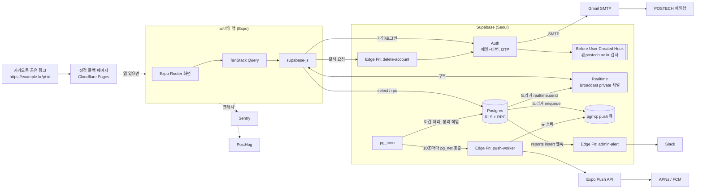
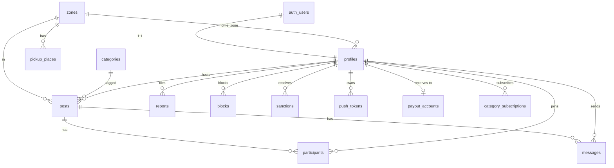

# 아키텍처 최종 설계 (v1.0)

> 기능 범위와 일정은 [기획서](./기획서.md)를 따른다. 이 문서는 **구현의 기준**이다. 여기서 바뀌는 내용은 반드시 이 문서에 먼저 반영한다.
> 임시 값: 앱 이름 `APP_NAME`, 공유 링크 도메인 `example.kr`(메일 발송에는 쓰지 않는다), 발신 메일 `postechdeliverymate@gmail.com`, 구역 이름 `구역 A/B/C`. 모두 출시 전에 바꾼다.

## 0. 확정된 결정 사항
| 항목 | 결정 |
|---|---|
| 대상 | POSTECH 구성원 전용. 인증된 `@postech.ac.kr` 메일만 가입할 수 있다. |
| 인증 | Supabase Auth의 메일 + 비밀번호 방식. 6자리 메일 OTP로 가입을 인증하고 비밀번호를 재설정한다. |
| 메일 발송 | **팀 공용 Gmail의 SMTP**(앱 비밀번호)를 Supabase Auth의 커스텀 SMTP로 연결한다. 발신 주소는 `postechdeliverymate@gmail.com`이다. 예상 발송량이 하루 100통 이하라서 도메인을 사지 않는다. 정지되거나 발송량이 늘면 Resend와 자체 도메인으로 바꾼다(2026-11-23 확정). |
| 구역 | **구역별로 피드를 나눈다.** 구역 목록은 `zones` 테이블의 데이터로 관리한다(임시로 3개). 사용자는 홈 구역을 하나 고르고, 피드에서 다른 구역으로 바꿔 볼 수 있다. |
| 재인증 | 출시 후에 넣는다. `profiles.verified_at` 컬럼만 미리 만들어 둔다. |
| 결제 | **수동 선송금.** 외부 PG를 쓰지 않는다. 참여자가 마감 뒤 방장 계좌로 직접 송금하고, 앱은 계좌 노출 범위 제어와 송금 여부 기록만 한다(2026-11-17 확정). |
| 채팅 메시지 | MVP는 **텍스트와 시스템 메시지만** 지원한다. 이미지는 LATER로 미룬다(모더레이션 부담과 Storage 비용 때문). |
| 앱 | Expo의 최신 안정 SDK(작업을 시작할 때 버전을 고정), New Architecture, dev client |
| 백엔드 | Supabase Pro, 서울 리전(ap-northeast-2) |

---

## 1. 시스템 구성도



**원칙**
1. 클라이언트의 **쓰기는 모두 RPC를 거친다.** 테이블에 직접 INSERT, UPDATE, DELETE할 수 없도록 `authenticated` 롤에서 권한을 REVOKE한다.
2. 읽기는 RLS가 걸린 `select`로 한다. 목록이나 집계는 RPC로 한다.
3. 실시간은 Broadcast만 쓴다. Postgres Changes는 쓰지 않는다.
4. `service_role` 키는 Edge Function 안에만 둔다. 앱에는 절대 넣지 않는다.

---

## 2. 데이터 모델

### 2-1. ERD


### 2-2. 테이블 정의
> 공통: 모든 테이블에 RLS를 켠다. 시각 컬럼은 모두 `timestamptz`(UTC 저장, 앱에서 KST로 표시)로 둔다. 별도 표기가 없으면 `id`는 `uuid default gen_random_uuid()`이다.

**zones**: 생활 구역
| 컬럼 | 타입 | 제약 |
|---|---|---|
| id | smallint identity | PK |
| name | text | not null, unique (예: 구역 A) |
| sort_order | smallint | not null default 0 |
| is_active | boolean | default true |

**pickup_places**: 픽업 장소 프리셋
| 컬럼 | 타입 | 제약 |
|---|---|---|
| id | smallint identity | PK |
| zone_id | smallint | FK zones, not null |
| name | text | not null, unique(zone_id, name) |
| sort_order, is_active | | |

**categories**
| 컬럼 | 타입 | 제약 |
|---|---|---|
| id | smallint identity | PK |
| name | text | unique (치킨, 피자, 한식, 중식, 일식, 분식, 야식, 카페·디저트, 기타) |
| emoji | text | |
| sort_order | smallint | |

**profiles**
| 컬럼 | 타입 | 제약 / 설명 |
|---|---|---|
| id | uuid | PK, FK auth.users ON DELETE CASCADE |
| nickname | text | unique(대소문자 무시: `lower(nickname)` 유니크 인덱스), 2~12자, `^[가-힣a-zA-Z0-9_]+$`, 금칙어 검사 |
| home_zone_id | smallint | FK zones |
| verified_at | timestamptz | 메일 인증 시각. 재인증 기능을 넣을 때 사용 |
| noshow_count | smallint | default 0 |
| notify_chat / notify_post_events / notify_marketing | boolean | default true / true / false |
| eula_agreed_at, terms_agreed_at | timestamptz | |
| is_admin | boolean | default false. 사용자가 바꿀 수 없다(RPC만 허용, 직접 UPDATE 불가) |
| deleted_at | timestamptz | 탈퇴 시 익명화한 시각 |
| created_at | timestamptz | default now() |

> 메일은 `profiles`에 저장하지 않는다. 다른 사용자에게 노출되지 않도록 `auth.users`에만 둔다.

**posts**: 공동구매 모집 글
| 컬럼 | 타입 | 제약 / 설명 |
|---|---|---|
| id | uuid | PK |
| host_id | uuid | FK profiles, not null |
| zone_id | smallint | FK zones, not null |
| category_id | smallint | FK categories, not null |
| store_name | text | 1~30자 |
| store_url | text | null 허용. `https://`만 허용, 500자 이하 |
| pickup_place_id | smallint | FK pickup_places, not null |
| pickup_note | text | null 허용, 50자 이하 (예: 1층 로비 앞) |
| max_members | smallint | check 2~8 (방장 포함) |
| member_count | smallint | default 1. RPC만 갱신한다 |
| deadline_at | timestamptz | 생성 시점 기준 10분 ~ 3시간 뒤 |
| fee_note | text | 100자 이하 (예: 배달비 4,000원 / 최소 15,000원) |
| memo | text | 500자 이하 |
| status | post_status enum | `open` / `closed` / `completed` / `canceled` |
| closed_at, completed_at, canceled_at | timestamptz | |
| pay_due_at | timestamptz | 송금 기한. 마감될 때 `closed_at + 30분`으로 채운다. 마감 전에는 null |
| pay_reminded_at | timestamptz | 송금 기한 임박 알림을 보낸 시각(중복 발송 방지) |
| hidden_at | timestamptz | 신고 누적으로 자동 숨김된 시각 |
| created_at | timestamptz | |

인덱스
- `posts_feed_idx (zone_id, deadline_at, id) WHERE status='open' AND hidden_at IS NULL` (피드 복합 커서 순서와 같다)
- `posts_host_idx (host_id, created_at DESC)`

**participants**
| 컬럼 | 타입 | 제약 / 설명 |
|---|---|---|
| post_id | uuid | FK posts ON DELETE CASCADE |
| user_id | uuid | FK profiles |
| role | participant_role | `host` / `member` |
| state | participant_state | `joined` / `left` / `dropped` / `kicked` |
| paid_state | paid_state | `none` / `sent` / `confirmed` (방장은 항상 `none`) |
| paid_at | timestamptz | 마지막으로 `sent`가 된 시각 |
| muted | boolean | default false |
| last_read_message_id | bigint | default 0 |
| joined_at, left_at | timestamptz | |

- PK는 `(post_id, user_id)`이다. 나갔다가 다시 참여하면 기존 행의 `state`를 `joined`로 되돌린다. 단, `kicked`인 사용자는 다시 참여할 수 없다.
- 인덱스: `participants_user_idx (user_id) WHERE state='joined'`

**messages**
| 컬럼 | 타입 | 제약 / 설명 |
|---|---|---|
| id | bigint identity | PK. 커서 페이지네이션 기준 |
| post_id | uuid | FK posts ON DELETE CASCADE |
| sender_id | uuid | FK profiles ON DELETE SET NULL. 시스템 메시지는 null |
| type | message_type | `text` / `system` |
| body | text | 1~1000자 |
| client_msg_id | uuid | 같은 메시지가 중복 전송되는 것을 막는 키. unique(sender_id, client_msg_id) |
| hidden_at | timestamptz | 신고로 숨긴 시각 |
| created_at | timestamptz | |

- 인덱스: `messages_room_idx (post_id, id DESC)`

**payout_accounts**: 송금 받을 계좌 (사용자당 1행)
| 컬럼 | 타입 | 제약 / 설명 |
|---|---|---|
| user_id | uuid | PK, FK profiles ON DELETE CASCADE |
| bank_name | text | null 허용. 은행 이름(앱의 은행 목록에서 고름) |
| account_number | text | null 허용. 숫자와 `-`만, 10~20자 |
| account_holder | text | null 허용. 예금주, 2~20자 |
| toss_link | text | null 허용. `https://toss.me/`로 시작하는 링크만 |
| updated_at | timestamptz | |

- check: (bank_name, account_number, account_holder가 모두 있음) 또는 toss_link가 있음.
- 계좌는 `profiles`에 두지 않는다. 다른 사용자는 `get_host_account` RPC로만 읽는다.
- 탈퇴하면 행을 바로 삭제한다(`delete-account`).

**reports**
| 컬럼 | 타입 | 설명 |
|---|---|---|
| id | uuid | PK |
| reporter_id | uuid | |
| target_type | report_target | `post` / `message` / `user` / `noshow` |
| target_post_id, target_message_id, target_user_id | | 대상에 맞는 컬럼만 채운다 |
| reason | report_reason | `spam` / `abuse` / `scam` / `inappropriate` / `noshow` / `unpaid` / `other` |
| detail | text | 500자 이하 |
| status | report_status | `pending` / `actioned` / `dismissed` |
| handled_by, handled_at | | |
| created_at | | unique(reporter_id, target_type, 대상 id)로 같은 사람이 같은 대상을 중복 신고하지 못하게 한다 |

**blocks**: `(blocker_id, blocked_id)` PK, created_at

**sanctions**: user_id, type(`warn` / `suspend` / `ban`), reason, starts_at, ends_at(null이면 영구), created_by
- `is_sanctioned(uid)` 함수는 지금 유효한 `suspend` 또는 `ban`이 있으면 true를 반환한다.

**push_tokens**: id, user_id, expo_token(unique), platform(`ios` / `android`), updated_at

**category_subscriptions**: `(user_id, zone_id, category_id)` PK. 구독한 구역에 그 카테고리 글이 새로 올라오면 알림을 보낸다.

**banned_words**: word(PK). RPC가 닉네임, 글, 메시지를 저장하기 전에 검사한다.

**deleted_accounts**: email_hash(PK, `sha256(lower(email) + pepper)`), noshow_count, deleted_at. 90일이 지나면 cron이 삭제한다.

**rate_events**: user_id, action, created_at. 요청 횟수를 제한하는 데 쓰고, 1시간이 지난 행은 cron이 삭제한다.

### 2-3. 헬퍼 함수 (STABLE, SECURITY DEFINER, `search_path=''`)
- `is_verified_member()`: `auth.jwt()->>'email'`이 `@postech.ac.kr`로 끝나고, `email_confirmed_at`이 있고, 프로필이 있고 탈퇴하지 않았으면 true다.
- `is_participant(p_post uuid)`: 현재 사용자가 그 글에 `state='joined'`로 들어가 있는지 확인한다.
- `is_blocked_between(a uuid, b uuid)`: 두 사용자 중 한쪽이라도 상대를 차단했는지 확인한다.
- `is_sanctioned(uid uuid)`
- `can_view_payout(p_post uuid)`: 현재 사용자가 그 글의 `joined` 참여자이고, 글이 `closed` 또는 `completed`일 때 true다. 방장 계좌 노출의 유일한 관문이다.
- `is_admin()`: 현재 사용자가 인증된 회원이고 `profiles.is_admin`이 true면 true다. reports·sanctions의 관리자 열람 정책에 쓴다. 본인만 판단하므로 authenticated에 실행 권한을 준다.
- `assert_rate(action text, max int, window interval)`: 제한을 넘으면 `RATE_LIMITED` 예외를 던진다.
- `assert_clean(text)`: 금칙어가 있으면 `BANNED_WORD` 예외를 던진다.

---

## 3. 인증 상세

### 3-1. 도메인 강제 (Before User Created Hook)
```sql
create or replace function public.hook_before_user_created(event jsonb)
returns jsonb language plpgsql security definer set search_path = '' as $$
declare v_email text := lower(trim(event->'user'->>'email'));
begin
  if v_email is null or v_email !~ '^[a-z0-9._%+-]+@postech\.ac\.kr$' then
    return jsonb_build_object('error', jsonb_build_object(
      'http_code', 403,
      'message', 'POSTECH 메일(@postech.ac.kr)만 가입할 수 있습니다'));
  end if;
  if exists (select 1 from public.deleted_accounts d
             where d.email_hash = encode(extensions.digest(v_email || public.email_pepper(), 'sha256'), 'hex')
               and d.noshow_count >= 3) then
    return jsonb_build_object('error', jsonb_build_object(
      'http_code', 403, 'message', '이용이 제한된 계정입니다'));
  end if;
  return '{}'::jsonb;
end $$;
-- supabase_auth_admin에만 실행 권한을 주고, 다른 롤에서는 REVOKE한다
```
- `email_pepper()`는 Supabase Vault(`vault.decrypted_secrets`)에서 pepper를 읽는 SECURITY DEFINER 함수다. `supabase_auth_admin`과 함수 소유자만 실행할 수 있다.
- 대시보드의 Auth Hooks 설정에서 이 함수를 등록한다. 등록 상태는 환경마다 체크리스트로 확인한다.
- 이 hook이 빠지는 사고가 나더라도 `is_verified_member()`가 모든 RLS 정책의 전제 조건이라 데이터는 노출되지 않는다.

### 3-2. Auth 설정값
| 설정 | 값 |
|---|---|
| Confirm email | ON |
| 이메일 OTP 길이와 만료 | 6자리, 10분 |
| 비밀번호 | 최소 8자, 영문과 숫자 필수, Leaked password protection ON |
| SMTP | Gmail (`smtp.gmail.com:465`), 사용자 이름과 발신 주소 `postechdeliverymate@gmail.com`, 비밀번호는 Google 앱 비밀번호, 발신 이름 `APP_NAME` |
| Rate limit | 메일 발송은 시간당 30건(프로젝트 전체, 출시 후 조정), 같은 주소로 재발송은 60초 간격 |
| CAPTCHA | Cloudflare Turnstile. 가입과 비밀번호 재설정에 적용 |
| JWT 만료 | 3600초. 리프레시 토큰 회전 ON |
| Email change | 앱에서 막는다. 화면을 제공하지 않는다 |
| Redirect URL | 쓰지 않는다. OTP 코드 방식만 쓴다 |

메일 템플릿(Confirm signup, Reset password)에는 `{{ .Token }}` 6자리만 크게 보여주고 링크는 넣지 않는다.

### 3-3. 클라이언트 흐름
```
sign-up:   signUp({email,password, options:{captchaToken}}) → verify 화면
verify:    verifyOtp({email, token, type:'signup'}) → 세션 발급 → profile-setup
profile-setup: rpc('create_profile', {nickname, home_zone_id, agree_terms, agree_eula})
               → (선택, 건너뛰기 가능) rpc('set_payout_account', {...})
post/new:  계좌가 없으면 계좌 입력 시트를 먼저 띄운다(서버는 ACCOUNT_REQUIRED로 강제)
sign-in:   signInWithPassword → 'Email not confirmed' 에러면 resend({type:'signup'})를 보내고 verify 화면으로
forgot:    resetPasswordForEmail(email,{captchaToken}) → verifyOtp({type:'recovery'}) → updateUser({password})
change pw: signInWithPassword로 현재 비밀번호를 재확인 → updateUser({password})
delete:    비밀번호 재확인 → functions.invoke('delete-account')
```
- 앱의 라우팅 가드는 다음 순서로 동작한다.
  1. 세션이 없으면 `(auth)`로 보낸다.
  2. 세션이 있는데 프로필이 없으면 `profile-setup`으로 보낸다.
  3. 둘 다 있으면 `(tabs)`로 보낸다.

---

## 4. RPC(API) 명세

> 모든 RPC는 공통으로 다음을 따른다.
> - 함수 속성: `SECURITY DEFINER`, `set search_path=''`
> - 시작할 때 `is_verified_member()`와 `NOT is_sanctioned(auth.uid())`를 검사한다.
> - 실패하면 `raise exception using errcode='P0001', message='<CODE>'`로 에러를 던진다. 앱은 `message`에 담긴 코드를 보고 한국어 문구로 바꿔 보여준다.

| RPC | 입력 | 동작 요약 | 반환 |
|---|---|---|---|
| `create_profile` | nickname, home_zone_id, agree_terms, agree_eula | 동의 둘 다 true가 아니거나 닉네임 형식·구역(없음·비활성)이 틀리면 `INVALID_INPUT`, 이미 프로필이 있으면 `INVALID_STATE`. 닉네임 금칙어·중복 검사 후 profiles에 insert, verified_at·terms_agreed_at·eula_agreed_at=now(). `deleted_accounts`에 같은 메일 기록이 있으면 noshow_count를 이어 받는다 | profile |
| `set_payout_account` | bank_name?, account_number?, account_holder?, toss_link? | 본인 계좌 upsert. 빈 문자열은 null로 보고, 모두 null이면 삭제. 은행 3필드는 모두 채우거나 모두 비운다. 형식 검사(`INVALID_INPUT`) | void |
| `get_host_account` | post_id | `can_view_payout(post_id)`가 false면 `NOT_PARTICIPANT`. 현재 방장의 계좌를 반환(없으면 null) | account \| null |
| `update_profile` | nickname?, home_zone_id?, notify_* ? | 수정 | profile |
| `create_post` | zone_id, category_id, store_name, store_url?, pickup_place_id, pickup_note?, max_members, deadline_minutes(10~180), fee_note?, memo? | 방장 계좌가 없으면 `ACCOUNT_REQUIRED`, 요청 횟수 제한(1시간에 5회), 금칙어 검사, 방장 participant 생성, 시스템 메시지, 카테고리 구독자에게 푸시 큐 | post |
| `join_post` | post_id | 아래 3-1 순서 | participant |
| `leave_post` | post_id | 아래 4-2 규칙 | void |
| `kick_member` | post_id, user_id | 방장만, `open` 상태일 때만 | void |
| `close_post` | post_id | 방장만, `open` → `closed` | post |
| `complete_post` | post_id | 방장만, `closed` → `completed` | post |
| `cancel_post` | post_id, reason? | 방장만, `open`이나 `closed`에서 → `canceled` | post |
| `send_message` | post_id, body, client_msg_id | 참여자만, 10초에 10회 제한, 금칙어 검사, insert, 방송 트리거, 푸시 큐 | message |
| `mark_read` | post_id, message_id | last_read 갱신(값이 커질 때만) | void |
| `mark_paid` | post_id | 멤버가 `none` → `sent`. 글이 `closed`이고 `pay_due_at` 전일 때만(지나면 `PAY_DEADLINE_PASSED`). 시스템 메시지, 방장에게 푸시 | void |
| `confirm_paid` | post_id, user_id | 방장이 `sent` → `confirmed`. 시스템 메시지, 멤버에게 푸시 | void |
| `reject_paid` | post_id, user_id | 방장이 `sent` → `none`(입금 안 됨). `confirmed`는 되돌릴 수 없음(`INVALID_STATE`). 시스템 메시지, 멤버에게 푸시 | void |
| `get_feed` | zone_id, cursor_deadline?, cursor_id?, limit=20 | 모집 중이고 숨기지 않은 글, 차단한 사용자의 글 제외. `(deadline_at, id)` 오름차순. 다음 페이지는 이전 페이지 마지막 행의 `deadline_at`, `id`를 넘기고 `(deadline_at, id) > (cursor_deadline, cursor_id)`로 고른다. 커서 둘 중 하나만 주면 `INVALID_INPUT` | posts(zone_id 제외) + 방장 닉네임 |
| `get_my_rooms` | — | 참여 중인 방 목록 + 마지막 메시지 + 안 읽은 수(최대 99) | rooms[] |
| `get_messages` | post_id, before_id?, after_id?, limit=50 | 참여자만. 커서 없음: 최신 limit개(id 내림차순). `before_id`: 그보다 이전 limit개(id 내림차순). `after_id`: 그 이후를 오래된 것부터 limit개(id 오름차순, 꽉 차면 앱이 이어서 호출). 둘 다 주면 `INVALID_INPUT` | messages[] |
| `report` | target_type, target_id, reason, detail?, post_id? | 같은 신고 중복 방지, 신고 누적 시 자동 숨김. `target_id`는 post·user는 uuid, message는 id를 문자열로. `target_type='noshow'`(사유 `noshow`·`unpaid`)는 `target_id`=대상 사용자, `post_id`=어느 방인지(필수, 없으면 `INVALID_INPUT`). 다른 대상에서는 무시한다. 방 단위로 1회 세기 위해 쓴다(4-3) | void |
| `block_user` / `unblock_user` | user_id | | void |
| `register_push_token` | token, platform | upsert | void |
| `subscribe_category` / `unsubscribe_category` | zone_id, category_id | | void |
| `admin_*` | — | `is_admin`만: 신고 처리, 제재 부여·해제, 글·메시지 숨김 해제 | |

### 4-1. `join_post` 처리 순서
1. `select ... from posts where id=$1 for update`로 글 행을 잠근다.
2. 순서대로 검사한다.
   - 글이 없거나 숨김 상태면 `POST_NOT_FOUND`
   - `status<>'open'`이거나 `deadline_at<=now()`이면 `POST_CLOSED`
   - `member_count>=max_members`이면 `POST_FULL`
   - 방장과 서로 차단한 사이면 `BLOCKED`
   - 이전에 `kicked`된 사용자면 `KICKED`
   - 동시에 참여 중인 방이 5개를 넘으면 `TOO_MANY_ROOMS`
3. participants에 upsert한다(`state='joined'`, 이미 참여 중이면 아무것도 하지 않음). 새로 참여한 경우에만 `member_count`를 1 늘린다.
4. 시스템 메시지 "○○님이 참여했어요"를 넣고, 방장에게 보낼 푸시를 큐에 넣는다.

### 4-2. 상태 전이 규칙

**글(posts.status)**
| 현재 | 이벤트 | 다음 | 누가 |
|---|---|---|---|
| open | 방장이 마감 / `deadline_at` 도달(cron) | closed (`pay_due_at = closed_at + 30분`) | 방장 / 시스템 |
| open | 방장이 취소 / 멤버 없이 방장이 나감 | canceled | 방장 / 시스템 |
| closed | 방장이 완료 | completed | 방장 |
| closed | 마감 후 12시간 경과(cron) | completed | 시스템 |
| closed | 방장이 취소 | canceled. `paid_state`가 `sent`·`confirmed`인 멤버가 있으면 방장과 그 멤버에게 환불 안내 푸시 | 방장 |
| completed, canceled | — | 종료 상태 | 채팅은 읽기 전용이 되고 7일 뒤 방이 목록에서 사라진다 |

- 정원이 차도 자동으로 마감하지 않는다. 참여 버튼만 꺼지고, 누가 나가면 다시 켜진다.
- 방장 화면의 "주문하러 가기"(`store_url` 열기) 버튼은 `joined` 멤버가 모두 `confirmed`일 때만 켠다. 서버 상태가 아니라 앱 표시 규칙이다.

**참여자(participants.state)**
| 상황 | 결과 |
|---|---|
| `open`일 때 멤버가 나감 | `left`, member_count -1 |
| `closed`일 때 멤버가 나감 | `dropped`(이탈 기록), member_count -1, 방장에게 푸시 |
| `open`일 때 방장이 강퇴 | `kicked`, 다시 참여 불가 |
| 방장이 나감 | 가장 먼저 참여한 `joined` 멤버에게 방장을 넘기고 시스템 메시지. 넘길 멤버가 없으면 글을 `canceled`로. `closed` 이후 위임이면 이미 보낸 돈은 이전 방장에게 있으므로 시스템 메시지로 환불 안내 |
| `closed`이고 `pay_due_at`이 지났는데 `paid_state='none'`인 멤버(cron) | `dropped`(이탈 기록), member_count -1, 시스템 메시지, 본인과 방장에게 푸시 |

**송금(participants.paid_state)**: `none` → (멤버 `mark_paid`) `sent` → (방장 `confirm_paid`) `confirmed`. 방장은 확인 전에 `reject_paid`로 `sent` → `none`(입금 안 됨)으로 되돌릴 수 있다. `confirmed`는 되돌릴 수 없다. `completed` 이후에는 바꿀 수 없다. 송금은 `closed` 상태에서만 가능하다.

### 4-3. 신고와 제재 자동화
- **post / message 신고:** 서로 다른 사용자 3명이 신고하면 `hidden_at=now()`로 숨기고 관리자에게 Slack 알림을 보낸다. 관리자가 숨김을 해제할 수 있다.
- **noshow / unpaid 신고:** `closed`나 `completed` 상태인 방의 참여자만 할 수 있다. 신고가 1건 이상 들어온 방이 하나 늘 때마다 `noshow_count`를 1 늘린다. 같은 방에서 여러 번 신고돼도 1회로 센다.
- **누적 제재:** `noshow_count`가 3이 되면 14일 정지, 5가 되면 영구 정지를 자동으로 건다. 사용자는 운영 메일로 이의를 제기할 수 있다.
- **SLA:** 모든 신고는 Slack으로 알림을 보내고 24시간 안에 처리한다.

### 4-4. 에러 코드
`NOT_VERIFIED`, `SANCTIONED`, `PROFILE_REQUIRED`, `NICKNAME_TAKEN`, `BANNED_WORD`, `RATE_LIMITED`, `POST_NOT_FOUND`, `POST_CLOSED`, `POST_FULL`, `BLOCKED`, `KICKED`, `TOO_MANY_ROOMS`, `NOT_HOST`, `NOT_PARTICIPANT`, `INVALID_STATE`, `INVALID_INPUT`, `DUPLICATE_REPORT`, `ACCOUNT_REQUIRED`, `PAY_DEADLINE_PASSED`

---

## 5. RLS 정책 요약
| 테이블 | SELECT | INSERT / UPDATE / DELETE |
|---|---|---|
| zones, pickup_places, categories | `is_verified_member()` | 관리자 마이그레이션만 |
| profiles | 인증된 회원이면 볼 수 있다. 단 공개 뷰 `public_profiles`(id, nickname, noshow_level)만 노출한다. `noshow_level`은 noshow_count 범주로 0회 `none`, 1~2회 `some`, 3회 이상 `many`다. 테이블은 자기 행만(전체 컬럼) 볼 수 있다 | RPC만 |
| posts | 인증된 회원은 `hidden_at is null`인 글, 그리고 자기가 참여한 글을 볼 수 있다 | RPC만 |
| participants | 같은 글의 참여자 | RPC만 |
| payout_accounts | 본인 행만. 다른 사람은 `get_host_account` RPC로만(`can_view_payout`) | RPC만 |
| messages | `is_participant(post_id)` 그리고 (`hidden_at is null` 또는 본인 메시지) | RPC만 |
| reports | 본인이 낸 것, 관리자 | RPC만 |
| blocks, push_tokens, category_subscriptions | 본인 행 | RPC만 |
| sanctions | 본인, 관리자 | 관리자 RPC |
| banned_words, deleted_accounts, rate_events | 없음 | 함수 내부에서만 |
| `realtime.messages` | topic `room:{post_id}`에 대해 `is_participant`가 true일 때 구독 가능 | 클라이언트는 방송 불가(서버 트리거만 방송) |

작성 규칙
- `auth.uid()`는 항상 `(select auth.uid())`로 감싼다.
- 정책에서 다른 테이블을 조회할 때는 헬퍼 함수를 거친다.
- pgTAP 테스트를 테이블마다 최소 2개 쓴다(허용되는 경우 1개, 거부되는 경우 1개).

---

## 6. 실시간 채팅
- **채널:** `room:{post_id}`, `private: true`. 앱은 입장할 때 `supabase.realtime.setAuth()`를 호출한다.
- **방송:** `messages` AFTER INSERT 트리거에서 `realtime.send(payload, 'message', 'room:'||post_id, true)`를 호출한다. 상태 변경이나 송금 체크 같은 사건도 `'event'` 타입으로 같은 채널에 방송한다.
- **앱 동작**
  1. 방에 들어가면 `get_messages`로 최근 50개를 불러오고 채널을 구독한다.
  2. 방송으로 받은 메시지는 id를 기준으로 중복을 걸러 목록에 붙인다.
  3. 메시지를 보낼 때는 `client_msg_id`를 붙여 먼저 화면에 표시하고(낙관적 표시), RPC 응답이 오면 서버 값으로 교체한다.
  4. 앱이 백그라운드에서 돌아오면 채널을 다시 구독하고 `get_messages(after_id = 마지막 id)`로 빠진 메시지를 채운다. 결과가 limit개로 꽉 차면 마지막 id로 다시 부른다.
  5. 차단한 사용자의 메시지는 앱에서 접어서 "차단한 사용자의 메시지"로 표시한다.
- **보존:** 종료된 방의 메시지는 90일 뒤 cron이 삭제한다. 신고된 메시지는 `reports`에 원문 스냅샷을 남긴다.

---

## 7. 푸시 알림

### 7-1. 알림 매트릭스
| 이벤트 | 받는 사람 | 문구 예시 | 끌 수 있는 설정 | 묶어서 보내기 |
|---|---|---|---|---|
| 새 메시지 | 보낸 사람을 뺀 참여자 | "[BBQ 같이] 닉네임: 메시지…" | notify_chat, 방별 muted | 같은 방은 사용자별로 30초에 1건, "새 메시지 N개" |
| 새 참여자 | 방장 | "○○님이 참여했어요 (3/4)" | notify_post_events | 30초 |
| 정원 다 참 | 방장 | "인원이 다 모였어요! 마감해 주세요" | notify_post_events | 없음 |
| 마감 10분 전 | 방장 | "곧 마감돼요 (2/4)" | notify_post_events | 없음 |
| 마감 (cron 또는 방장) | 전체 참여자 | "모집이 마감됐어요. 송금하고 '보냈어요'를 눌러주세요" | 끌 수 없음 | 없음 |
| 송금 표시 | 방장 | "○○님이 송금했다고 표시했어요" | notify_post_events | 30초 |
| 송금 기한 임박 (기한 10분 전) | `paid_state='none'`인 멤버 | "10분 안에 송금하지 않으면 방에서 빠져요" | 끌 수 없음 | 없음 |
| 입금 안 됨 | 해당 멤버 | "방장이 입금을 확인하지 못했어요. 다시 확인해 주세요" | 끌 수 없음 | 없음 |
| 송금 확인 | 해당 멤버 | "방장이 입금을 확인했어요" | notify_post_events | 없음 |
| 송금 기한 초과로 빠짐 | 본인, 방장 | "송금 기한이 지나 방에서 빠졌어요" / "○○님이 송금하지 않아 빠졌어요" | 끌 수 없음 | 없음 |
| 환불 안내 (송금 후 취소) | 방장, 송금한 멤버 | "모집이 취소됐어요. 송금한 금액은 방장에게 환불을 요청하세요" / "송금한 참여자에게 환불해 주세요" | 끌 수 없음 | 없음 |
| 이탈 (마감 후 나감) | 방장 | "○○님이 나갔어요" | 끌 수 없음 | 없음 |
| 방장 위임 | 새 방장 | "방장이 되었어요" | 끌 수 없음 | 없음 |
| 취소 | 전체 참여자 | "모집이 취소됐어요" | 끌 수 없음 | 없음 |
| 관심 카테고리 새 글 | 구독자(방장 제외) | "구역 A에 새 치킨 공구가 올라왔어요" | 구독 해제 | 사용자별로 10분에 1건 |

- 공통으로 차단 관계인 사람에게는 보내지 않는다.
- 23시~08시에는 "관심 카테고리 새 글" 알림만 보내지 않는다. 직접 참여한 방의 알림은 이 시간대에도 보낸다.

### 7-2. 발송 파이프라인
1. RPC와 트리거가 `pgmq.send('push', {user_ids, kind, post_id, title, body, collapse_key})`로 큐에 넣는다.
2. pg_cron이 10초마다 `pg_net`으로 `push-worker`를 호출한다.
3. `push-worker`가 처리하는 순서
   1. 큐에서 최대 500건을 꺼낸다.
   2. collapse_key가 같은 알림을 하나로 합치고, 수신 설정·mute·차단을 다시 확인한다.
   3. 사용자를 토큰으로 바꾼다.
   4. Expo Push API로 100건씩 묶어 보낸다.
   5. receipt를 확인해서 `DeviceNotRegistered`가 오면 그 토큰을 삭제한다.
   6. 실패하면 3회까지 재시도하고, 그래도 실패하면 archive로 옮긴다.
4. 앱은 지금 보고 있는 방의 알림은 포그라운드에서 띄우지 않는다. 알림을 탭하면 `/post/{id}/chat`으로 이동한다.
5. Android 알림 채널은 `chat`, `post_events`, `marketing` 세 개로 나눈다.

---

## 8. 스케줄 작업 (pg_cron)
| 주기 | 작업 |
|---|---|
| 1분 | `open`이면서 `deadline_at<now()`인 글을 `closed`로 바꾼다(UPDATE ... RETURNING). 시스템 메시지, 방송, 푸시도 함께 처리 |
| 1분 | 마감 10분 전 알림(`deadline_at` 기준 9~10분 남은 글, 아직 알림을 안 보낸 글만) |
| 1분 | 송금 기한 10분 전 알림(`pay_reminded_at is null`인 `closed` 글), 기한이 지난 미송금 멤버를 `dropped`로 |
| 10초 | push-worker 호출 |
| 1시간 | 마감 후 12시간이 지난 `closed` 글을 `completed`로 바꾼다. rate_events 정리 |
| 1일 03:00 KST | 90일 지난 메시지 삭제, 기간이 지난 deleted_accounts 삭제, 끝난 제재 정리 |

---

## 9. 앱 구조

```
app/
  _layout.tsx                # Provider, 인증 가드, 알림·딥링크·AppState 처리
  (auth)/permissions.tsx sign-in.tsx sign-up.tsx verify.tsx
        forgot-password.tsx reset-password.tsx profile-setup.tsx
  (tabs)/_layout.tsx
        index.tsx            # 피드 (상단 구역 칩, 마감순 목록, 빈 화면)
        rooms.tsx            # 내 채팅방 (안 읽은 수)
        settings.tsx
  post/new.tsx               # 모달, 글 작성
  post/[id]/index.tsx        # 상세 + 참여
  post/[id]/chat.tsx         # 채팅 (송금 체크 바, 방장 메뉴)
  settings/notifications.tsx payout-account.tsx blocked.tsx change-password.tsx delete-account.tsx terms.tsx
src/
  features/{auth,profile,posts,chat,moderation,notifications}/{api.ts,hooks.ts,schema.ts,components/}
  components/ui/             # Button, Input, Chip, Card, Sheet, Badge, EmptyState, Toast …
  lib/supabase.ts queryClient.ts mmkv.ts sentry.ts analytics.ts kakao.ts linking.ts errors.ts(에러 코드 → 한국어)
  constants/strings.ts theme.ts
  types/database.ts          # supabase gen types
supabase/
  migrations/                # 0001_extensions, 0002_tables, 0003_helpers, 0004_rls, 0005_rpc, 0006_triggers, 0007_cron, 0008_seed
  functions/push-worker/ admin-alert/ delete-account/
  tests/                     # pgTAP
web/                         # 공유 링크 폴백 페이지 + AASA + assetlinks.json (Cloudflare Pages)
docs/
```

- **서버 상태 쿼리 키:** `['feed', zoneId]`, `['post', id]`, `['rooms']`, `['messages', postId]`, `['me']`
- **입력 검증:** 앱의 zod 스키마와 서버 RPC의 검증 규칙을 같은 숫자로 맞춘다(글자 수, 인원 범위 등). 기준 숫자는 `src/constants/limits.ts` 한 곳에서 관리한다.

---

## 10. 딥링크와 공유
- **공유 링크:** `https://example.kr/p/{post_id}`
  - 앱이 깔려 있으면 Universal Link / App Link로 `/post/{id}`가 열린다.
  - 앱이 없으면 폴백 페이지가 OG 태그(가게명, 인원, 마감 시각)와 스토어 버튼을 보여준다.
- **폴백 페이지의 데이터 노출:** 비로그인 상태이므로 DB를 직접 조회하지 않는다. 링크에는 post_id만 담고, 페이지에는 "POSTECH 인증 후 확인할 수 있어요"만 표시한다. 글 내용이 외부에 노출되지 않는다.
- **카카오톡 공유:** `@react-native-kakao/share`의 피드 템플릿을 쓰고, 버튼 링크는 위 URL이다.
- **카카오 콘솔 키 해시:** 디버그 키, EAS 업로드 키, **Play 앱 서명 키** 세 개를 모두 등록한다.

---

## 11. 환경과 비밀키
| 환경 | Supabase | EAS 프로필 | 용도 |
|---|---|---|---|
| local | `supabase start` (Docker) | development (dev client) | 개발과 pgTAP |
| staging | 별도 프로젝트 (Free 또는 Pro) | preview (내부 배포, TestFlight) | QA와 베타 |
| production | Pro, 서울 리전 | production | 스토어 |

**앱 환경변수 (`EXPO_PUBLIC_*`, 공개되어도 되는 값)**
- SUPABASE_URL, SUPABASE_ANON_KEY, SENTRY_DSN, POSTHOG_KEY, KAKAO_NATIVE_APP_KEY, LINK_DOMAIN

**비밀키 (앱에 넣으면 안 되는 값)**
| 보관 위치 | 항목 |
|---|---|
| Supabase secrets (Edge Function) | SERVICE_ROLE_KEY(자동 주입), EXPO_ACCESS_TOKEN, SLACK_WEBHOOK_URL |
| Supabase Vault | email_pepper |
| Supabase Auth 설정 | Gmail 앱 비밀번호(SMTP), Turnstile secret |
| EAS credentials | APNs 키(.p8), FCM v1 서비스 계정, Android keystore |
| GitHub Actions secrets | SUPABASE_ACCESS_TOKEN, SUPABASE_DB_PASSWORD(staging/prod), EXPO_TOKEN |

**CI (GitHub Actions)**
- PR이 올라오면: lint, typecheck, `supabase db reset`, pgTAP을 실행한다.
- main에 머지되면: staging에 `db push`와 functions deploy를 하고, EAS Update preview를 배포한다.
- 태그(`v*`)를 달면: production에 `db push`하고, EAS Build와 Submit을 한다. 이 단계는 수동 승인이 있어야 실행된다.

---

## 12. 관측과 분석
- **Sentry:** 앱과 Edge Function에 붙인다. 릴리스와 소스맵을 연결한다.
- **PostHog 이벤트**
  - `signup_started`, `signup_verified`, `profile_created`
  - `feed_viewed{zone}`, `post_created{category,max,deadline_min}`, `post_viewed`, `post_joined`, `post_left{after_close}`
  - `post_closed{by:host|cron, members}`, `post_completed`, `post_canceled{reason}`
  - `message_sent`, `paid_marked`, `paid_confirmed`, `paid_rejected`, `pay_expired`, `payout_account_set`, `share_clicked`, `share_opened`
  - `category_subscribed`, `report_submitted{type}`
- **핵심 지표 SQL 뷰:** 매칭률(참여자가 2명 이상인 마감 글의 비율), 첫 참여까지 걸린 시간의 중앙값, 일간 글 수, D7 리텐션
- **알림:** DB CPU 80% 이상, Realtime 동시 접속이 플랜 한도의 70% 이상, push-worker 실패율 5% 이상이면 Slack으로 알린다.

---

## 13. 보안 체크리스트 (출시 전 필수)
- [ ] 모든 테이블 RLS ON, `authenticated` 롤의 직접 쓰기 권한 REVOKE 확인
- [ ] 모든 SECURITY DEFINER 함수에 `search_path=''` 지정, 함수 안에서 `auth.uid()` 검사
- [ ] Before User Created Hook을 3개 환경 모두에 등록
- [ ] 미인증 토큰과 다른 도메인 토큰으로 데이터를 조회하면 0건인지 테스트
- [ ] Supabase Advisors(보안, 성능) 경고 0건
- [ ] service_role 키가 앱 번들과 git에 없는지 확인 (gitleaks)
- [ ] Turnstile, 요청 횟수 제한, 금칙어 동작 확인
- [ ] 개인정보처리방침에 수집 항목(메일, 닉네임, 송금 받을 계좌, 기기 토큰, 이용 기록), 국외 이전(Google(Gmail), Sentry, PostHog, Expo), 보관 기간(메일 해시 90일, 메시지 90일, 계좌는 탈퇴 즉시 삭제)을 기재
- [ ] 방장 계좌가 마감 전 참여자와 비참여자에게 보이지 않는지 pgTAP으로 확인. Sentry·PostHog 이벤트에 계좌번호가 실리지 않는지 확인

---

## 14. 비용 추정 (월)
| 항목 | 1천 MAU | 1만 MAU |
|---|---|---|
| Supabase Pro + 컴퓨트 | $25 | $25~$60 |
| 메일 발송(Gmail SMTP) | $0 (하루 약 500통 한도) | Resend와 도메인으로 교체, $20 (월 5만 통) |
| 도메인(공유 링크용, 선택) | 연 1~2만 원 | 동일 |
| Expo EAS | $0 (Free) ~ $19 | $19~$99 |
| Sentry, PostHog | $0 (무료 구간) | $0~$26 |
| Apple 개발자 / Google Play | 연 $99 / 1회 $25 | 동일 |
| **합계** | **약 4~7만 원** | **약 10~25만 원** |
> 가격은 변동될 수 있다. 계약하기 전에 각 서비스의 현재 가격을 다시 확인한다.
